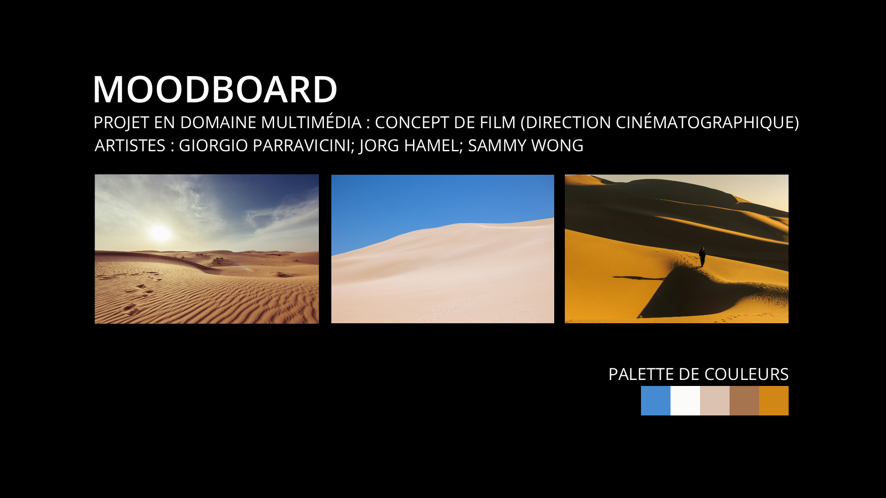

# Les vers sacrés

Projet conçu en équipe avec : Rémi, Federer

## Le concept et l'audience

- Concept : Documentaire sur les vers des sables
- Une phrase (logline) : Découvrez les mystérieux vers de sable d'Arrakis, des créatures géantes qui dominent le désert et jouent un rôle essentiel dans l'écosystème de la planète.
- Le public cible : Adultes
- La franchise d'origine : Dune

## L'intrigue

- Le début : Naissance
- Le milieu : Mode de vie
- Le revirement (plot twist) : Malgré leur taille imposante, il est possible de chevaucher les vers des sables.
- La fin : Le chercheur fait une découverte sur l'origine des vers des sables.

## Le personnage principal

- Description (physique et psychologique) : âge moyen, équipement adapté, sac à dos, nonchalant
- Son désir (ce qu'il veut) : Vouloir être reconnu par ses pairs
- Son besoin (ce qu'il lui faut) : Se passionner pour son travail
- Son évolution : Amateur -> professionnel et méthodique

## L'univers

- Où et quand se passe l'histoire : Sur la planète Arrakis
- Un élément de folklore qui rend l'univers vivant : Souris du désert, civilisation Fremen

## La direction cinématographique

- La palette de couleurs : Bleu pâle, blanc, beige, brun, orange
- L'éclairage : Clair et intense avec contrastes forts
- Le rythme du montage : Lent
- Un moodboard (3 à 5 images de référence) :

